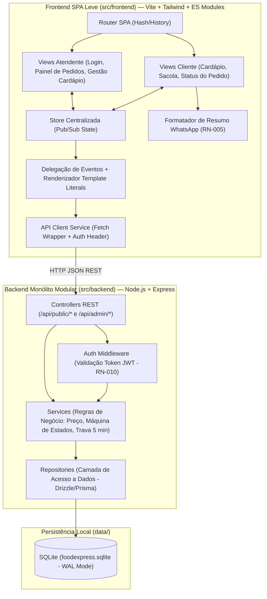

# Diretrizes de Arquitetura e Tecnologia — FoodExpress

> **Status:** Concluído no `/passo2` (Aguardando Aprovação Formal do Usuário)
> **Versão:** 1.0.0
> **Última Atualização:** 2026-11-11
> **Metodologia:** Vibe Coding Sensato & Spec Driven Development (SDD)

---

## 1. Princípios Arquiteturais

1. **Spec-First (SDD):** Nenhuma implementação de código ocorre sem especificação prévia aprovada em [`docs/brd.md`](./brd.md) e [`docs/trd.md`](./trd.md).
2. **Simplicidade e Modularidade (Monólito Modular em Camadas):** Separação estrita entre responsabilidades de interface (`src/frontend`), regras de negócio e API (`src/backend`) e suíte de verificação automatizada (`tests/`), permitindo que a equipe de 3 pessoas trabalhe em paralelo nas Sprints 1 e 2 sem conflitos de código.
3. **Execução Local Zero-Config (Sem Dependências Externas Complexas):** Banco de dados relacional em arquivo único local (**SQLite** gerenciado via **Drizzle ORM** / **Prisma**), sem necessidade de provisionar servidores de banco externos ou containers pesados para rodar o projeto.
4. **Renderização Leve e Reativa no Cliente:** Arquitetura **Single-Page Application (SPA) Leve** utilizando **Vite + Vanilla JS Modular (ES Modules) + Tailwind CSS**, estruturada com **Store Centralizada (Padrão Pub/Sub)**, renderização declarativa via **Template Literals** e **Delegação de Eventos** centralizada no DOM.
5. **Segurança e Confiabilidade desde o Design:** Senhas de atendentes armazenadas com hash criptográfico irreversível (`node:crypto scrypt`), autenticação administrativa via token assinado (`JWT` / HMAC-SHA256) e cobertura automatizada integral das regras de negócio críticas (`RNF-003`).

---

## 2. Stack Tecnológica Definida (Com Análise de Trade-offs)

| Camada | Tecnologia / Framework | Versão Alvo | Justificativa Técnica & Trade-offs |
| :--- | :--- | :--- | :--- |
| **Frontend / UI** | **Vite + Vanilla JS Modular (ES Modules) + Tailwind CSS** | Vite 5.x / ES2023 / Tailwind 3.x | **Prós:** Bundle mínimo, altíssima velocidade no celular (`RNF-001`), controle total do DOM via Template Literals e Delegação de Eventos sem overhead de Virtual DOM.<br>**Contras:** Exige disciplina de sanitização HTML (`escapeHtml`) e organização explícita da Store Pub/Sub. |
| **Backend / API** | **Node.js + Express** | Node 20+ / Express 4.x | **Prós:** Leve, amplamente conhecido, inicialização instantânea, excelente suporte a middlewares REST (autenticação, validação de payloads e tratamento centralizado de erros).<br>**Contras:** Single-threaded (plenamente suficiente para a carga operacional de lanchonetes e restaurantes de pequeno/médio porte). |
| **Banco de Dados & ORM** | **SQLite (Arquivo Local) + Drizzle ORM** *(ou Prisma ORM)* | SQLite 3 (`better-sqlite3`) + Drizzle ORM | **Prós:** Banco relacional ACID real em arquivo único (`data/foodexpress.sqlite`), tipagem forte de schema, migrations/seed instantâneos e zero dependência de infraestrutura externa.<br>**Contras:** Escrita concorrente massiva é limitada pelo lock de arquivo do SQLite (mitigado com `PRAGMA journal_mode = WAL;`). |
| **Autenticação & Segurança** | **JWT (HMAC-SHA256) + Hash `scrypt` (`node:crypto`)** | Nativo Node.js | **Prós:** Usa o módulo criptográfico nativo do Node.js sem pacotes nativos quebradiços, garantindo senhas irreversíveis (`RNF-002`) e proteção stateless nas rotas `/api/admin/*` (`RN-010`). |
| **Testes Automatizados** | **Vitest + Supertest** | Vitest 2.x / Supertest 7.x | **Prós:** Compatível nativamente com Vite e ES Modules, execução em milissegundos para validar todas as regras financeiras, limites de 140 caracteres, máquina de estados e janela de 5 minutos (`RNF-003`). |
| **Infra / CI-CD** | **GitHub Actions + Deploy Automatizado** | Node 20 Alpine | **Prós:** Atende diretamente às tarefas técnicas `T01` (CI em cada push/PR) e `T02` (CD automático após testes verdes). |

---

## 3. Visão de Componentes e Fluxo de Dados

### 3.1. Diagrama de Arquitetura em Camadas



### 3.2. Estratégia de Manipulação do DOM e Renderização Visual
Para garantir alta performance em celulares (`RNF-001`) sem dependências complexas de frameworks reativos pesados:
1. **Estado Único (Store Pub/Sub):** Um módulo `store.js` mantém o estado da sessão em memória (`menuCategories`, `cart`, `activeOrder`, `adminOrders`, `authUser`, `pollingIntervalMs`) e notifica os inscritos (`store.subscribe(listener)`) sempre que uma ação altera os dados.
2. **Renderização Declarativa via Template Literals:** Cada tela ou componente (`ProductCard`, `CartDrawer`, `OrderStatusCard`, `AdminOrderRow`) é uma função pura que recebe o estado sanitizado (via helper `escapeHtml()`) e retorna uma string HTML estruturada com classes utilitárias do **Tailwind CSS**.
3. **Delegação de Eventos Centralizada:** Em vez de recriar dezenas de `addEventListener` a cada re-renderização, o container raiz escuta eventos (`click`, `input`, `submit`, `change`) usando atributos `data-action="..."` e `data-id="..."` nos elementos HTML, garantindo zero vazamento de memória (memory leaks) e resposta imediata ao toque.
4. **Persistência Local de Apoio (`localStorage`):** A sacola em andamento (`foodexpress_cart`), o ID do último pedido do cliente (`foodexpress_last_order_id`), o token do atendente (`foodexpress_admin_token`) e o intervalo de atualização automática configurado (`foodexpress_poll_ms`, padrão `300000` ms = 5 min) são sincronizados no `localStorage` para sobreviver a recarregamentos de página.

---

## 4. Organização de Pastas e Padrões de Código

```text
foodexpress/
├── docs/                          # Fonte Única de Verdade SDD (contexto, arquitetura, brd, trd, sessao_agente)
├── data/                          # Arquivo SQLite local (foodexpress.sqlite) gerado automaticamente
├── src/
│   ├── backend/
│   │   ├── config/                # Configurações de ambiente e variáveis (.env)
│   │   ├── db/
│   │   │   ├── schema.js          # Definição das tabelas (Drizzle ORM / SQLite)
│   │   │   ├── connection.js      # Conexão SQLite em modo WAL e inicialização de tabelas
│   │   │   └── seed.js            # Carga inicial de atendente padrão, categorias, produtos, variações e adicionais
│   │   ├── middlewares/
│   │   │   ├── authMiddleware.js  # Verificação de token nas rotas administrativas (RN-010)
│   │   │   └── errorHandler.js    # Tratamento padronizado de erros HTTP (400, 401, 403, 404, 422, 500)
│   │   ├── repositories/
│   │   │   ├── categoryRepo.js    # Persistência de categorias
│   │   │   ├── productRepo.js     # Persistência de produtos, variações e adicionais
│   │   │   ├── orderRepo.js       # Persistência de pedidos e itens do pedido
│   │   │   └── userRepo.js        # Consulta de credenciais de atendentes
│   │   ├── services/
│   │   │   ├── authService.js     # Hash scrypt, verificação de senha e emissão de token
│   │   │   ├── menuService.js     # Regras RN-001 e RN-011 (validação de preço > 0, filtro de ativos, cálculo de opcionais)
│   │   │   └── orderService.js    # Regras RN-002 a RN-008 (sacola, mesa/nome, WhatsApp, máquina de estados, trava 5 min)
│   │   ├── controllers/
│   │   │   ├── authController.js  # POST /api/auth/login
│   │   │   ├── menuController.js  # Rotas públicas e administrativas do cardápio
│   │   │   └── orderController.js # Criação, consulta de status, avanço linear e cancelamento de pedidos
│   │   ├── routes/
│   │   │   └── apiRoutes.js       # Registro centralizado de endpoints da API
│   │   └── app.js                 # Instância Express (exportável para Supertest sem subir porta TCP)
│   └── frontend/
│       ├── index.html             # Entrada única da SPA (Mobile-First)
│       ├── main.js                # Bootstrap da aplicação, roteador e delegação de eventos global
│       ├── styles/
│       │   └── main.css           # Diretivas Tailwind CSS e utilitários visuais
│       ├── state/
│       │   └── store.js           # Store Pub/Sub centralizada (sacola, cardápio, pedido ativo, painel admin)
│       ├── services/
│       │   ├── api.js             # Cliente HTTP para comunicação com /api/*
│       │   ├── whatsapp.js        # Gerador de mensagem padronizada e link wa.me (RN-005)
│       │   └── polling.js         # Gerenciador do timer configurável (padrão 5 min) e refresh manual (RN-009)
│       ├── components/            # Componentes visuais puros (Template Literals)
│       │   ├── Navbar.js
│       │   ├── ProductCard.js
│       │   ├── ProductModal.js    # Seleção de variação, adicionais e observação (máx 140 chars)
│       │   ├── CartDrawer.js      # Sacola, alternância Local/Entrega, validação de Mesa/Nome
│       │   └── OrderBadge.js      # Indicadores visuais de status e cronômetro regressivo de 5 min
│       └── views/
│           ├── CustomerMenuView.js    # Cardápio público e sacola (US02, US03, US04, US05, US06, US13)
│           ├── OrderTrackingView.js   # Acompanhamento pelo cliente, botão WhatsApp e cancelamento <= 5 min (US08, US11, US12)
│           ├── AdminLoginView.js      # Tela de login restrito (US07)
│           ├── AdminOrdersView.js     # Fila de preparo, avanço linear, cancelamento e polling 5 min (US09, US10, US11)
│           └── AdminMenuView.js       # CRUD de categorias, produtos, variações e adicionais (US01, US13)
├── tests/
│   ├── unit/                      # Testes de unidade das regras de negócio (preço, 140 chars, estados, 5 min, WhatsApp)
│   └── integration/               # Testes de integração dos endpoints da API (Supertest + SQLite em memória/teste)
├── package.json
└── vite.config.js
```

### Convenções de Engenharia
- **Padrão de Commits:** Conventional Commits (`feat:`, `fix:`, `test:`, `docs:`, `chore:`).
- **Variáveis de Ambiente (`.env.example`):**
  - `PORT=3000` (Porta do servidor Node/Express)
  - `DATABASE_URL=./data/foodexpress.sqlite` (Caminho do banco SQLite local)
  - `JWT_SECRET=foodexpress-local-dev-secret-key` (Chave de assinatura de tokens administrativos)
  - `RESTAURANT_WHATSAPP=5511999999999` (Número oficial do restaurante para direcionamento da Entrega)
  - `ADMIN_DEFAULT_USER=admin` e `ADMIN_DEFAULT_PASS=admin123` (Credenciais iniciais criadas no seed automático)
