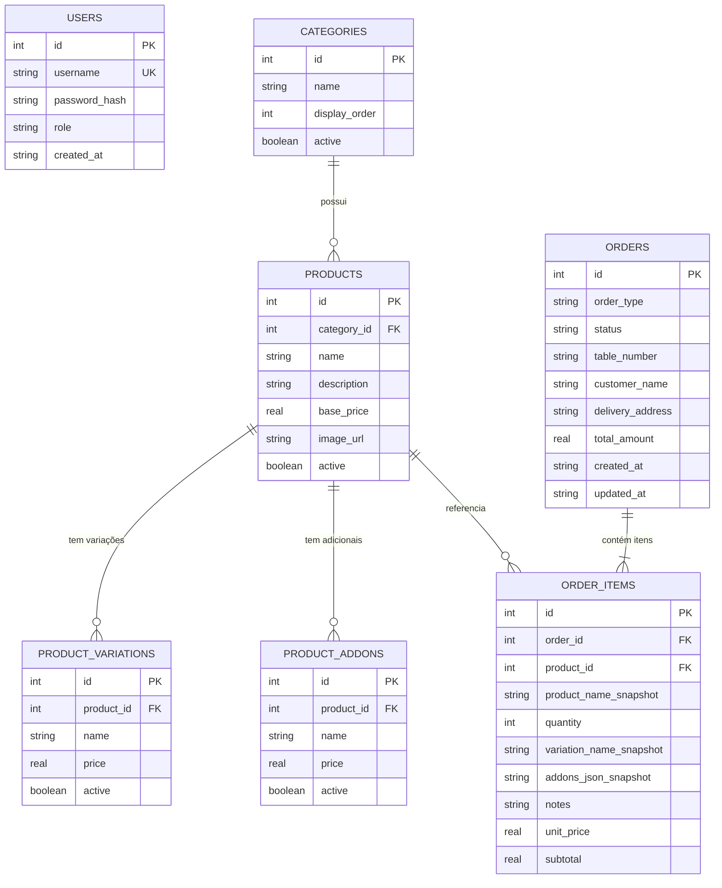
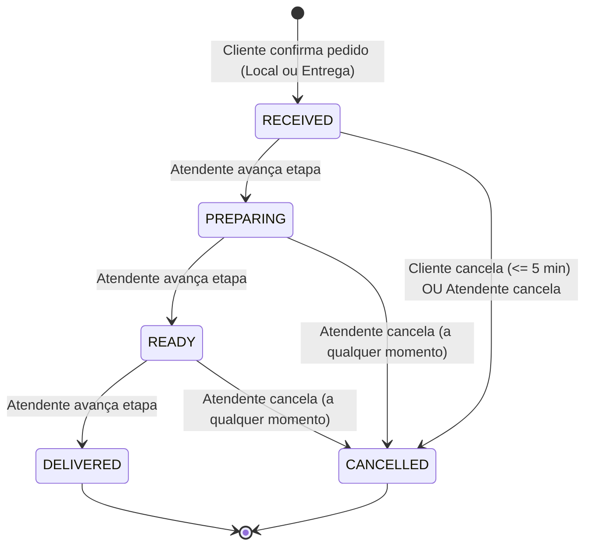

# Technical Requirement Document (TRD) — FoodExpress

> **Status:** Concluído no `/passo2` (Aguardando Aprovação Formal do Usuário)
> **Versão:** 1.0.0
> **Última Atualização:** 2026-11-11
> **Documento Base:** [`docs/brd.md`](./brd.md) e [`docs/arquitetura.md`](./arquitetura.md)

---

## 1. Matriz de Rastreabilidade Técnica (BRD -> TRD)

Garantia de **100% de cobertura** entre os Requisitos Funcionais (`RF-001` a `RF-013`), Regras de Negócio (`RN-001` a `RN-012`) e Requisitos Não-Funcionais (`RNF-001` a `RNF-004`) do BRD:

| ID Técnico | Ref. BRD (`RF`/`RN`/`RNF`) | Componente / Módulo | Especificação Técnica de Implementação | Complexidade | Status |
| :--- | :--- | :--- | :--- | :---: | :---: |
| `TR-001` | `RF-001`, `RN-001`, `RN-010` | `menuService` / `AdminMenuView` | CRUD administrativo de categorias e produtos com validação estrita de `name` não vazio e `basePrice > 0`. Produtos possuem flag booleana `active` (padrão `true`). Rotas protegidas por `authMiddleware`. | `Média` | `Especificado` |
| `TR-002` | `RF-002`, `RN-001` | `menuService` / `CustomerMenuView` | Endpoint público `GET /api/public/menu` que retorna apenas categorias ativas contendo produtos com `active = true`, incluindo suas variações e adicionais ativos ordenados. | `Baixa` | `Especificado` |
| `TR-003` | `RF-003`, `RN-011`, `RN-012` | `store.js` / `orderService` | Gerenciamento de sacola no cliente (Store Pub/Sub + `localStorage`) e revalidação no backend ao confirmar pedido: `unitPrice = (variationPrice ?? productBasePrice) + sum(addonsPrices)`. Subtotal do item = `unitPrice * quantity`. Bloqueia pedidos sem itens ou com total `<= 0`. | `Média` | `Especificado` |
| `TR-004` | `RF-004`, `RN-002` | `ProductModal` / `orderService` | Campo de observação opcional por item da sacola com atributo HTML `maxlength="140"`, contador visual de caracteres na UI e validação server-side (`notes.length <= 140`), recusando payloads excedentes com HTTP `422`. | `Baixa` | `Especificado` |
| `TR-005` | `RF-005`, `RF-006`, `RN-003` | `CartDrawer` / `orderService` | Seleção de modalidade (`DINE_IN` para Consumo no local ou `DELIVERY` para Entrega). Validação condicional: se `DINE_IN`, exige `tableNumber` preenchido; se `DELIVERY`, exige `customerName` preenchido (e campo opcional `deliveryAddress` para compor o resumo). Sem necessidade de login/cadastro do cliente. | `Baixa` | `Especificado` |
| `TR-006` | `RF-007`, `RN-010`, `RNF-002` | `authService` / `authMiddleware` | Autenticação de atendente via `POST /api/auth/login`. Senhas armazenadas com `node:crypto scrypt` + salt aleatório. Emissão de token assinado (HMAC-SHA256) exigido no header `Authorization: Bearer <token>` em todas as rotas `/api/admin/*`. | `Média` | `Especificado` |
| `TR-007` | `RF-008`, `RN-005`, `RN-012` | `whatsapp.js` / `OrderTrackingView` | Geração determinística de texto padronizado para pedidos `DELIVERY` contendo: código do pedido (`#ID`), nome do cliente, endereço/referência (se informado), lista de itens com quantidades, variação, adicionais, observações e valor total formatado em BRL (`R$`), gerando URL `https://wa.me/<numero>?text=<encodeURIComponent(texto)>`. | `Baixa` | `Especificado` |
| `TR-008` | `RF-009`, `RN-004`, `RN-009` | `polling.js` / `AdminOrdersView` | Todo pedido confirmado (Local ou Entrega) nasce com `status = 'RECEIVED'` e `createdAt` ISO-8601. O painel do atendente executa polling automático a cada `300000 ms` (5 minutos por padrão), permitindo ao operador configurar o intervalo (mínimo `10000 ms` = 10s para evitar sobrecarga) ou acionar o botão "Atualizar Agora". | `Média` | `Especificado` |
| `TR-009` | `RF-010`, `RN-006` | `orderService` / `AdminOrdersView` | Máquina de estados finita (FSM) estrita no backend: transições normais permitidas apenas em `RECEIVED` → `PREPARING` (`Em preparo`) → `READY` (`Pronto`) → `DELIVERED` (`Entregue`). Qualquer tentativa de pular etapas ou retroceder status retorna HTTP `422 Unprocessable Entity`. | `Média` | `Especificado` |
| `TR-010` | `RF-011`, `RN-007`, `RN-008` | `orderService` / `OrderTrackingView` | Duas rotas distintas de cancelamento:<br>1. **Cliente (`POST /api/public/orders/:id/cancel`):** Permite transição para `CANCELLED` somente se `status === 'RECEIVED'` **e** `(now - createdAt) <= 300000 ms` (5 minutos). Na UI, um timer regressivo oculta o botão após 5 min.<br>2. **Atendente (`POST /api/admin/orders/:id/cancel`):** Permite cancelar qualquer pedido ativo (`RECEIVED`, `PREPARING`, `READY`) a qualquer instante sem exigir justificativa. | `Alta` | `Especificado` |
| `TR-011` | `RF-012`, `RN-006`, `RN-007` | `OrderTrackingView` | Tela pública de acompanhamento do pedido (`GET /api/public/orders/:id`) exibindo stepper visual do status atual (`Recebido`, `Em preparo`, `Pronto`, `Entregue` ou `Cancelado`), botão de reabrir resumo no WhatsApp (se Entrega) e botão de cancelamento (se dentro dos 5 minutos iniciais e em `Recebido`). | `Baixa` | `Especificado` |
| `TR-012` | `RF-013`, `RN-011` | `menuService` / `ProductModal` | Suporte completo ao cadastro administrativo e seleção pelo cliente de **Variações** (`product_variations`, escolha única opcional/obrigatória que define ou ajusta o preço) e **Adicionais** (`product_addons`, múltipla escolha que soma valores extras ao item). | `Média` | `Especificado` |
| `TR-013` | `RNF-001`, `RNF-003`, `RNF-004` | `tests/` / `.github/workflows` | Layout Mobile-First com barra inferior de sacola fixa para uso com uma mão; suíte de testes automatizados (Vitest + Supertest) validando todas as regras críticas (`T01`) e pipeline CI/CD configurado (`T02`). | `Média` | `Especificado` |

---

## 2. Modelagem de Dados (Data Schema / ERD)

O banco de dados local utiliza **SQLite** gerenciado com schema tipado via **Drizzle ORM** (ou Prisma ORM). Valores monetários são armazenados em **centavos (`INTEGER`)** ou **`REAL` arredondado a 2 casas decimais** (padronizado no código com helper monetário para evitar erros de ponto flutuante IEEE 754).

### 2.1. Diagrama Entidade-Relacionamento (ERD)



### 2.2. Especificação das Tabelas (`src/backend/db/schema.js`)

| Entidade / Tabela | Campo | Tipo SQLite | Restrições | Descrição |
| :--- | :--- | :--- | :--- | :--- |
| **`users`** | `id` | `INTEGER` | `PK, AUTOINCREMENT` | Identificador único do operador/atendente |
| `users` | `username` | `TEXT` | `UNIQUE, NOT NULL` | Login do atendente (ex.: `admin`) |
| `users` | `password_hash` | `TEXT` | `NOT NULL` | Hash irreversível gerado com `scrypt` (`salt:hash`) (`RNF-002`) |
| `users` | `created_at` | `TEXT` | `NOT NULL` | Timestamp ISO-8601 de criação |
| **`categories`** | `id` | `INTEGER` | `PK, AUTOINCREMENT` | Identificador da categoria do cardápio |
| `categories` | `name` | `TEXT` | `NOT NULL` | Nome da categoria (ex.: `Lanches`, `Bebidas`, `Porções`) |
| `categories` | `display_order` | `INTEGER` | `NOT NULL, DEFAULT 0` | Ordem de exibição no cardápio |
| `categories` | `active` | `INTEGER (BOOLEAN)` | `NOT NULL, DEFAULT 1` | Visibilidade da categoria (`1` = Ativa, `0` = Inativa) |
| **`products`** | `id` | `INTEGER` | `PK, AUTOINCREMENT` | Identificador do produto |
| `products` | `category_id` | `INTEGER` | `FK -> categories.id, NOT NULL` | Categoria à qual o produto pertence |
| `products` | `name` | `TEXT` | `NOT NULL` | Nome do produto (`RN-001`) |
| `products` | `description` | `TEXT` | `DEFAULT ''` | Descrição detalhada dos ingredientes |
| `products` | `base_price` | `REAL` | `NOT NULL, CHECK(base_price > 0)` | Preço base positivo (`RN-001`) |
| `products` | `image_url` | `TEXT` | `DEFAULT ''` | URL ou caminho local da foto do produto |
| `products` | `active` | `INTEGER (BOOLEAN)` | `NOT NULL, DEFAULT 1` | Disponibilidade no cardápio público (`1` = Ativo, `0` = Inativo) |
| **`product_variations`** | `id` | `INTEGER` | `PK, AUTOINCREMENT` | Identificador da variação (`RF-013`) |
| `product_variations` | `product_id` | `INTEGER` | `FK -> products.id, NOT NULL` | Produto vinculado |
| `product_variations` | `name` | `TEXT` | `NOT NULL` | Nome da variação (ex.: `Simples`, `Duplo`, `300ml`, `500ml`) |
| `product_variations` | `price` | `REAL` | `NOT NULL, CHECK(price > 0)` | Preço específico desta variação (`RN-011`) |
| `product_variations` | `active` | `INTEGER (BOOLEAN)` | `NOT NULL, DEFAULT 1` | Se a variação está ativa para escolha |
| **`product_addons`** | `id` | `INTEGER` | `PK, AUTOINCREMENT` | Identificador do adicional pago (`RF-013`) |
| `product_addons` | `product_id` | `INTEGER` | `FK -> products.id, NOT NULL` | Produto vinculado |
| `product_addons` | `name` | `TEXT` | `NOT NULL` | Nome do adicional (ex.: `Bacon Extra`, `Cheddar`) |
| `product_addons` | `price` | `REAL` | `NOT NULL, CHECK(price >= 0)` | Valor somado ao preço unitário do item (`RN-011`) |
| `product_addons` | `active` | `INTEGER (BOOLEAN)` | `NOT NULL, DEFAULT 1` | Se o adicional está ativo |
| **`orders`** | `id` | `INTEGER` | `PK, AUTOINCREMENT` | Número sequencial do pedido (`#1`, `#2`...) |
| `orders` | `order_type` | `TEXT` | `NOT NULL` | `DINE_IN` (Consumo no local) ou `DELIVERY` (Entrega) (`RN-003`) |
| `orders` | `status` | `TEXT` | `NOT NULL, DEFAULT 'RECEIVED'` | `RECEIVED`, `PREPARING`, `READY`, `DELIVERED`, `CANCELLED` (`RN-006`) |
| `orders` | `table_number` | `TEXT` | `NULLABLE` | Obrigatório quando `order_type = 'DINE_IN'` (`RN-003`) |
| `orders` | `customer_name` | `TEXT` | `NULLABLE` | Obrigatório quando `order_type = 'DELIVERY'` (`RN-003`) |
| `orders` | `delivery_address` | `TEXT` | `NULLABLE` | Dados complementares de endereço para o resumo de entrega |
| `orders` | `total_amount` | `REAL` | `NOT NULL, CHECK(total_amount > 0)` | Valor total consolidado do pedido (`RN-011`) |
| `orders` | `created_at` | `TEXT` | `NOT NULL` | Timestamp UTC ISO-8601 usado na regra dos 5 minutos (`RN-007`) |
| `orders` | `updated_at` | `TEXT` | `NOT NULL` | Timestamp UTC ISO-8601 da última transição de status |
| **`order_items`** | `id` | `INTEGER` | `PK, AUTOINCREMENT` | Identificador do item dentro do pedido |
| `order_items` | `order_id` | `INTEGER` | `FK -> orders.id, NOT NULL` | Pedido ao qual o item pertence |
| `order_items` | `product_id` | `INTEGER` | `FK -> products.id, NOT NULL` | Referência ao produto original |
| `order_items` | `product_name_snapshot` | `TEXT` | `NOT NULL` | Nome congelado no ato da compra (histórico imutável) |
| `order_items` | `quantity` | `INTEGER` | `NOT NULL, CHECK(quantity > 0)` | Quantidade solicitada (`RF-003`) |
| `order_items` | `variation_name_snapshot`| `TEXT` | `NULLABLE` | Nome e valor da variação escolhida no momento do pedido |
| `order_items` | `addons_json_snapshot` | `TEXT` | `NOT NULL, DEFAULT '[]'` | JSON com lista de adicionais escolhidos `[{name, price}]` |
| `order_items` | `notes` | `TEXT` | `DEFAULT '', CHECK(length(notes) <= 140)` | Observação do item limitada a 140 caracteres (`RN-002`) |
| `order_items` | `unit_price` | `REAL` | `NOT NULL` | Preço unitário calculado (Variação/Base + Adicionais) |
| `order_items` | `subtotal` | `REAL` | `NOT NULL` | `unit_price * quantity` |

---

## 3. Contratos de API / Interfaces (Endpoints REST)

| ID | Método & Rota | Ref. BRD | Auth / Role | Payload de Entrada (Request) | Resposta de Sucesso (Response) | Códigos de Erro |
| :--- | :--- | :--- | :--- | :--- | :--- | :--- |
| `API-001` | `POST /api/auth/login` | `RF-007`, `RN-010` | Público | `{ "username": "admin", "password": "..." }` | `200 OK` `{ "token": "jwt...", "user": { "username": "admin" } }` | `400, 401` |
| `API-002` | `GET /api/public/menu` | `RF-002`, `RN-001`, `RF-013` | Público (`ACT-01`) | *(Sem corpo)* | `200 OK` `{ "categories": [{ "id", "name", "products": [{ "id", "name", "basePrice", "variations": [...], "addons": [...] }] }] }` *(Apenas ativos)* | `500` |
| `API-003` | `POST /api/public/orders` | `RF-003` a `RF-006`, `RF-008`, `RN-001` a `RN-005`, `RN-011` | Público (`ACT-01`) | `{ "orderType": "DINE_IN" \| "DELIVERY", "tableNumber": "12", "customerName": "João", "deliveryAddress": "Rua A, 10", "items": [{ "productId": 1, "variationId": 2, "addonIds": [1, 3], "quantity": 2, "notes": "Sem cebola" }] }` | `201 Created` `{ "order": { "id": 101, "status": "RECEIVED", "totalAmount": 54.90, "createdAt": "...", "whatsappUrl": "https://wa.me/...", "whatsappMessage": "..." } }` | `400, 422` *(produto inativo, nota > 140 chars, sem mesa/nome)* |
| `API-004` | `GET /api/public/orders/:id` | `RF-012`, `RN-006`, `RN-007` | Público (`ACT-01`) | `Param :id` | `200 OK` `{ "order": { "id", "status", "orderType", "totalAmount", "createdAt", "canCustomerCancel": true, "remainingCancelSeconds": 245, "items": [...], "whatsappUrl": "..." } }` | `404` |
| `API-005` | `POST /api/public/orders/:id/cancel` | `RF-011`, `RN-007` | Público (`ACT-01`) | `Param :id` | `200 OK` `{ "order": { "id", "status": "CANCELLED", "updatedAt": "..." } }` | `404, 422` *(se > 5 min ou status != RECEIVED)* |
| `API-006` | `GET /api/admin/menu` | `RF-001`, `RF-013`, `RN-010` | Bearer Token (`ACT-02`) | *(Sem corpo)* | `200 OK` `{ "categories": [...], "products": [...] }` *(Inclui ativos e inativos)* | `401, 403` |
| `API-007` | `POST /api/admin/categories`<br>`PUT /api/admin/categories/:id` | `RF-001`, `RN-001`, `RN-010` | Bearer Token (`ACT-02`) | `{ "name": "Lanches", "displayOrder": 1, "active": true }` | `201 Created` / `200 OK` | `400, 401, 422` |
| `API-008` | `POST /api/admin/products`<br>`PUT /api/admin/products/:id`<br>`PATCH /api/admin/products/:id/toggle` | `RF-001`, `RF-013`, `RN-001`, `RN-011` | Bearer Token (`ACT-02`) | `{ "categoryId": 1, "name": "X-Burger", "description": "...", "basePrice": 25.00, "imageUrl": "...", "active": true, "variations": [{ "name": "Duplo", "price": 32.00 }], "addons": [{ "name": "Bacon", "price": 4.00 }] }` | `201 Created` / `200 OK` | `400, 401, 422` *(se preço <= 0 ou sem nome)* |
| `API-009` | `GET /api/admin/orders` | `RF-009`, `RN-004`, `RN-009` | Bearer Token (`ACT-02`) | `Query opcional ?status=ACTIVE` | `200 OK` `{ "orders": [...], "serverTime": "..." }` | `401` |
| `API-010` | `PATCH /api/admin/orders/:id/advance` | `RF-010`, `RN-006` | Bearer Token (`ACT-02`) | `{ "targetStatus": "PREPARING" \| "READY" \| "DELIVERED" }` *(ou avanço automático para o próximo estado válido)* | `200 OK` `{ "order": { "id", "status": "PREPARING", "updatedAt": "..." } }` | `401, 404, 422` *(transição inválida / pulo de etapa)* |
| `API-011` | `POST /api/admin/orders/:id/cancel` | `RF-011`, `RN-008` | Bearer Token (`ACT-02`) | `Param :id` *(Sem necessidade de justificativa)* | `200 OK` `{ "order": { "id", "status": "CANCELLED", "updatedAt": "..." } }` | `401, 404, 422` *(se já estiver DELIVERED ou CANCELLED)* |

---

## 4. Especificação Algorítmica das Regras de Negócio Críticas

### 4.1. Máquina de Estados Linear Estrita (`RN-006`, `RN-007`, `RN-008`)


- **Mapa de Transições Lineares (`NEXT_STATUS_MAP`):**
  - `RECEIVED` → `PREPARING`
  - `PREPARING` → `READY`
  - `READY` → `DELIVERED`
  - Qualquer tentativa de enviar um `targetStatus` diferente do próximo estado imediato é rejeitada com erro `422 Unprocessable Entity` (`"Transição de status inválida: não é permitido pular ou retroceder etapas"`).

### 4.2. Janela de Cancelamento de 5 Minutos pelo Cliente (`RN-007`)
- **Regra no Backend (`orderService.cancelByCustomer`):**
  1. Verifica se `order.status === 'RECEIVED'`. Caso contrário, lança erro `422` (`"O pedido já entrou em preparo ou foi finalizado e não pode ser cancelado pelo cliente"`).
  2. Calcula `elapsedMs = Date.now() - new Date(order.createdAt).getTime()`.
  3. Verifica se `elapsedMs <= 5 * 60 * 1000` (`300000 ms`). Caso `elapsedMs > 300000`, lança erro `422` (`"Prazo de 5 minutos para cancelamento pelo cliente expirado"`).

### 4.3. Formato Padronizado da Mensagem de Entrega para WhatsApp (`RN-005`)
```text
*🍔 NOVO PEDIDO #101 — FoodExpress*
*Modalidade:* Entrega
*Cliente:* João Silva
*Endereço/Ref:* Rua das Flores, 123 - Apto 4

*Itens do Pedido:*
• 2x X-Burger Artesanal (Variação: Duplo)
  + Adicionais: Bacon Extra, Cheddar
  _Obs: Sem cebola, maionese à parte_
  Subtotal: R$ 72,00

*Valor Total: R$ 72,00*
Acompanhe o status em: http://localhost:5173/#pedido/101
```

---

## 5. Requisitos Não-Funcionais Técnicos (Performance, Segurança e Qualidade)

| ID | Categoria | Ref. BRD | Especificação Técnica | Estratégia de Validação / Teste |
| :--- | :--- | :--- | :--- | :--- |
| `TNFR-001` | **Segurança e Autenticação** | `RNF-002`, `RN-010` | Senhas de operadores com hash `scrypt` (`node:crypto`) + salt de 16 bytes; Tokens administrativos assinados com HMAC-SHA256; sanitização contra XSS (`escapeHtml`) na renderização de Template Literals. | Testes automatizados tentando acessar `/api/admin/*` sem token (esperado `401`) e verificando que o hash salvo no banco nunca coincide com a senha em texto puro. |
| `TNFR-002` | **Responsividade Mobile-First** | `RNF-001` | Interface construída com Tailwind CSS priorizando viewports móveis (`360px` a `430px`), botões com área de toque mínima de `44x44px`, barra de categorias horizontal deslizante e sacola flutuante inferior acessível com o polegar. | Verificação visual e responsiva nos fluxos de Cardápio, Sacola e Acompanhamento. |
| `TNFR-003` | **Suíte Automatizada de Regras Críticas** | `RNF-003`, `T01` | Cobertura automatizada via **Vitest + Supertest** cobrindo obrigatoriamente: (1) cálculo de sacola com variações e adicionais, (2) ocultação de produtos inativos, (3) trava de 140 caracteres em observações, (4) exigência de mesa vs. nome por modalidade, (5) bloqueio de pulo de etapas na máquina de estados, (6) janela de 5 minutos no cancelamento do cliente vs. cancelamento livre do atendente. | Execução de `npm test` passando 100% dos testes unitários e de integração em banco SQLite isolado de teste. |
| `TNFR-004` | **Atualização Configurável do Painel** | `RN-009` | Timer de polling no painel administrativo iniciado em `300000 ms` (5 min), com seletor na UI permitindo alterar o intervalo (ex.: 30s, 1 min, 3 min, 5 min, 10 min) persistido em `localStorage`, além de botão "Atualizar Agora" com feedback visual imediato. | Teste funcional do gerenciador de polling e sincronização da fila. |

---

## 6. Dependências Externas, Integrações e Ambiente Local

| Pacote / Recurso | Finalidade | Estratégia em Ambiente Local | Variáveis de Ambiente |
| :--- | :--- | :--- | :--- |
| `express` / `cors` | Servidor HTTP e API REST | Executa localmente na porta configurada ou integrado ao servidor de desenvolvimento | `PORT=3000` |
| `better-sqlite3` + `drizzle-orm` | Persistência relacional SQLite e query builder tipado | Cria automaticamente o arquivo `./data/foodexpress.sqlite` (ou `:memory:` durante os testes automatizados) e roda o seed inicial | `DATABASE_URL=./data/foodexpress.sqlite` |
| `vite` + `tailwindcss` | Bundler frontend ES Modules e estilização Mobile-First | Servidor local com Hot Module Replacement (HMR) e proxy reverso de `/api` para o backend Express | `VITE_API_URL=/api` |
| `vitest` + `supertest` | Runner de testes unitários e de integração HTTP | Executa toda a suíte em memória em menos de 3 segundos sem depender de servidor externo rodando | `NODE_ENV=test` |
| **WhatsApp (`wa.me`)** | Direcionamento externo de pedidos de Entrega (`RN-005`) | Gera deep-link oficial `https://wa.me/<RESTAURANT_WHATSAPP>?text=...` e exibe modal/preview do resumo na tela de acompanhamento | `RESTAURANT_WHATSAPP=5511999999999` |

---

## 7. Plano de Execução e Testes para o `/passo3`

O plano de implementação abaixo está alinhado com as **Sprints 1 e 2** do BRD para execução no `/passo3`:

1. **Fase 1 — Setup do Repositório, Banco SQLite e Infraestrutura de Qualidade (`T01`):**
   - Inicializar `package.json`, configurar Vite, Tailwind CSS, Express, Drizzle ORM + SQLite e Vitest.
   - Criar `src/backend/db/schema.js`, `connection.js` e `seed.js` (criando o operador padrão e um cardápio rico com categorias, produtos ativos/inativos, variações e adicionais).
2. **Fase 2 — Backend Core: Autenticação, Cardápio e Regras de Pedido (Sprint 1 + Sprint 2 Backend):**
   - Implementar `authService` (`scrypt` + token JWT) e `authMiddleware` (`US07`).
   - Implementar `menuService` e rotas de categorias, produtos, variações e adicionais (`US01`, `US02`, `US13`).
   - Implementar `orderService` com cálculo de variações/adicionais (`US03`, `US13`), trava de 140 caracteres (`US04`), validação de mesa/nome por modalidade (`US05`, `US06`), geração de resumo WhatsApp (`US08`), máquina de estados linear estrita (`US10`) e regras de cancelamento de 5 minutos vs. atendente (`US11`, `US12`).
3. **Fase 3 — Frontend SPA Leve (Store Pub/Sub + Template Literals + Delegação de Eventos):**
   - Implementar `store.js`, cliente HTTP `api.js`, formatador `whatsapp.js` e serviço `polling.js` (5 min padrão + configurável + manual).
   - Construir a jornada Mobile-First do Cliente (`CustomerMenuView`, `ProductModal`, `CartDrawer`, `OrderTrackingView`).
   - Construir a jornada protegida do Atendente (`AdminLoginView`, `AdminOrdersView` com controle de fila e polling, `AdminMenuView` com CRUD completo).
4. **Fase 4 — Suíte de Testes Automatizados e Pipeline CI/CD (`RNF-003`, `T01`, `T02`):**
   - Implementar testes unitários e de integração cobrindo todos os critérios BDD do `docs/brd.md`.
   - Configurar workflow de CI/CD em `.github/workflows/ci-cd.yml` e validar execução completa local.
